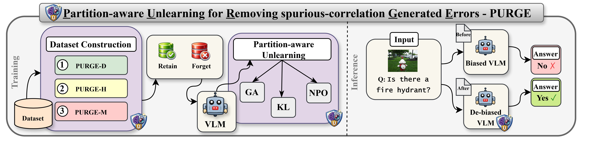
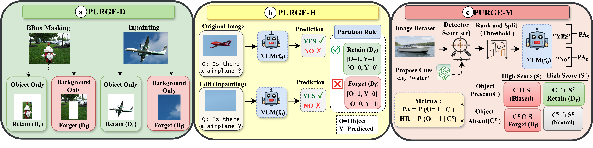

# PURGE: Partition-Aware Unlearning for Removing Spurious Correlations in Large Vision-Language Models

This is the code and dataset repository for **PURGE**, a framework for identifying and reducing object–context shortcuts in large vision-language models (LVLMs).



*Overall PURGE framework: dataset construction followed by partition-aware unlearning.*

## Overview

LVLMs can learn that an object is likely to appear with a particular background—for example, boats with water—and rely on that context instead of evidence from the object itself. PURGE creates controlled data partitions to study and reduce this shortcut reliance while preserving useful object knowledge.

PURGE has two stages:

1. **Dataset construction:** create partitions that distinguish object evidence from contextual cues.
2. **Partition-aware unlearning:** apply an unlearning objective to the selected forget partition while retaining the desired knowledge.

The paper evaluates three unlearning objectives: Gradient Ascent (GA), KL-regularized unlearning (KL), and Negative Preference Optimization (NPO).

## PURGE dataset variants



*Dataset construction for PURGE-D, PURGE-H, and PURGE-M.*

| Variant | Construction strategy | What it is designed to capture |
|---|---|---|
| **PURGE-D** | Data-level disentanglement | Separates object and background information using masking and inpainting. |
| **PURGE-H** | Hybrid, behavior-driven partitioning | Combines annotations, model predictions, and counterfactual inputs to find shortcut-driven behavior. |
| **PURGE-M** | Model-informed semantic partitioning | Uses object and contextual cues to form semantic partitions. |

## Dataset

The released, ready-to-use dataset is available at [Krishnaaditi1/PURGE on Hugging Face](https://huggingface.co/datasets/Krishnaaditi1/PURGE). It contains the processed PURGE-D, PURGE-H, and PURGE-M data, so you can use those files directly without running the generation scripts below.

| Dataset | Records | Approx. archive size | Purpose |
|---|---:|---:|---|
| PURGE-D | 47,838 | 4.6 GB | Data-level object/background disentanglement |
| PURGE-H | 16,700 | 2.4 GB | Hybrid behavior-driven partitions |
| PURGE-M | 20,633 | 3.2 GB | Model-informed object/context cue partitions |

The commands below are only for regenerating the data from source. COCO images and annotations, model checkpoints, and detector weights are external inputs; they are not bundled inside the released PURGE dataset. Obtain them from their official sources and follow their licenses.

## Repository layout

```text
PURGE/
├── Dataset_creation/   # PURGE-D, PURGE-H, and PURGE-M construction code
├── Evaluation/         # Benchmark evaluation code
├── Training/           # Unlearning and training code
├── Images/             # README figures: main_3.png and purge-dhm.png
├── requirements.txt
└── README.md
```

## Setup

Run commands from the repository root. Create an environment and install the repository dependencies:

```bash
python -m venv .venv
source .venv/bin/activate
python -m pip install --upgrade pip
pip install -r requirements.txt
```

The PURGE-H and PURGE-M generation scripts require a vision-language model checkpoint available on your machine. PURGE-M also uses a cue detector. These checkpoints are needed only when regenerating data; they are not required to download and use the released PURGE dataset.

## Experiments: dataset construction

Each variant has its own command and output directory. Before running a command, set `COCO_IMAGE_ROOT`, `COCO_ANN_JSON`, `PURGE_OUTPUT_ROOT`, and `LLAVA_MODEL_PATH` in your shell to the corresponding local locations. The examples do not assume or publish any user's machine paths. The example uses 100 samples per class where that option is supported; adjust this to match your experiment.

### 1. Generate PURGE-D

PURGE-D uses the image-disentanglement wrapper. By default, it processes all 80 COCO classes. To process selected classes, add `--classes "apple,airplane"` with your desired class names.

```bash
bash Dataset_creation/generate_purge_d_im.sh \
  --coco-root "$COCO_IMAGE_ROOT" \
  --ann-json "$COCO_ANN_JSON" \
  --output-root "$PURGE_OUTPUT_ROOT/PURGE_D" \
  --samples-per-class  \
  --quality-mode natural \
  --seed 
```

### 2. Generate PURGE-H

PURGE-H uses model predictions and counterfactual examples to construct behavior-driven partitions.

```bash
python Dataset_creation/PURGE_H.py \
  --coco_image_root "$COCO_IMAGE_ROOT" \
  --coco_ann_json "$COCO_ANN_JSON" \
  --output_root "$PURGE_OUTPUT_ROOT/PURGE_H" \
  --model_path "$LLAVA_MODEL_PATH" \
  --positive_per_class  \
  --negative_per_class  \
  --device cuda: \
  --seed 
```

### 3. Generate PURGE-M

PURGE-M uses semantic object/context cues to create the four object/cue presence groups.

```bash
python Dataset_creation/PURGE_M.py \
  --coco_image_root "$COCO_IMAGE_ROOT" \
  --coco_ann_json "$COCO_ANN_JSON" \
  --output_root "$PURGE_OUTPUT_ROOT/PURGE_M" \
  --vlm_model_path "$LLAVA_MODEL_PATH" \
  --num_cues 9 \
  --spur_k  \
  --select_by hr \
  --cue_detector_threshold  \
  --detector_device cuda: \
  --vlm_device cuda: \
  --max_images_per_class  \
  --max_materialized_per_combo \
  --link_mode hardlink \
  --seed 
```

Use distinct output directories for the variants. For other sampling, device, or class options, check the corresponding script's `--help` output.

## Experiments: unlearning and evaluation

### Models and benchmarks

The paper evaluates PURGE with LLaVA-1.6-7B, Qwen3-VL-8B-Instruct, and Qwen3.5-9B. CLIP is used for vision-language encoder experiments. The evaluation suite includes CHAIR, POPE, Causal-HalBench, MM-SpuBench, AMBER, MMHal, and Waterbirds.

### Unlearning protocol

The experiments compare GA, KL, and NPO using PURGE's partitioned data. The forget and retain partitions depend on the dataset variant and experiment. Keep the model checkpoint, dataset variant, partition assignment, unlearning objective, and random seed fixed and recorded when comparing runs.

Training and evaluation scripts are organized in `Training/` and `Evaluation/`. Their arguments can vary by model and benchmark; use the instructions and configuration files in those directories for the exact run commands and output locations. This README does not assume a single command or hardware configuration for every experiment.

| Experiment component | Options reported in the paper |
|---|---|
| Unlearning objectives | GA, KL, NPO |
| LVLMs | LLaVA-1.6-7B, Qwen3-VL-8B-Instruct, Qwen3.5-9B |
| Vision-language encoder | CLIP |
| Benchmarks | CHAIR, POPE, Causal-HalBench, MM-SpuBench, AMBER, MMHal, Waterbirds |

## Citation

```bibtex
@inproceedings{
anonymous2026partitionaware,
title={Partition-Aware Unlearning for Removing Spurious Correlations in Large Vision-Language Models},
author={Anonymous},
booktitle={The Fortieth Annual Conference on Neural Information Processing Systems Evaluations and Datasets Track},
year={2026},
url={https://openreview.net/forum?id=Tt3sSoAeJd}
}
```

## Acknowledgments

Our experiments use the COCO and Waterbirds datasets and evaluate models with CHAIR, POPE, Causal-HalBench, MM-SpuBench, AMBER, and MMHal. We thank the authors and maintainers for making these datasets and benchmarks available. We also acknowledge the authors of the pretrained models used in our experiments. Please cite the original works when using these resources. See the PURGE paper for the full experimental setup and references.
